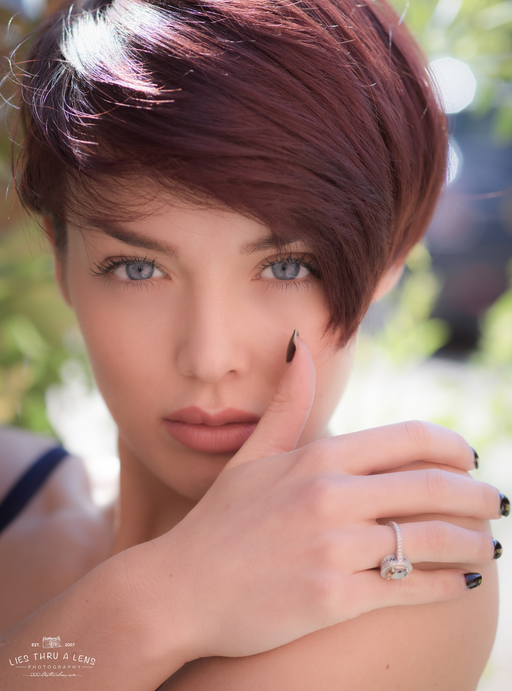
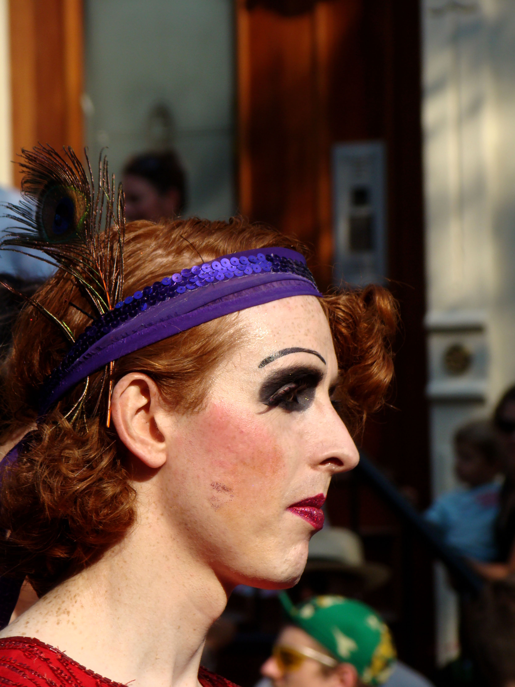
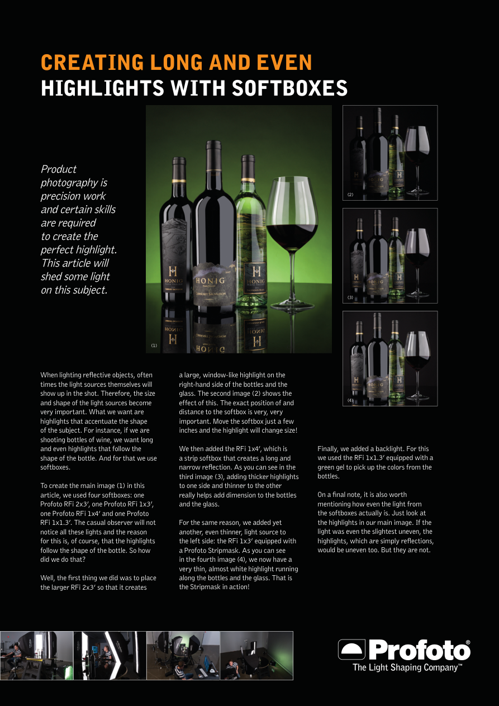
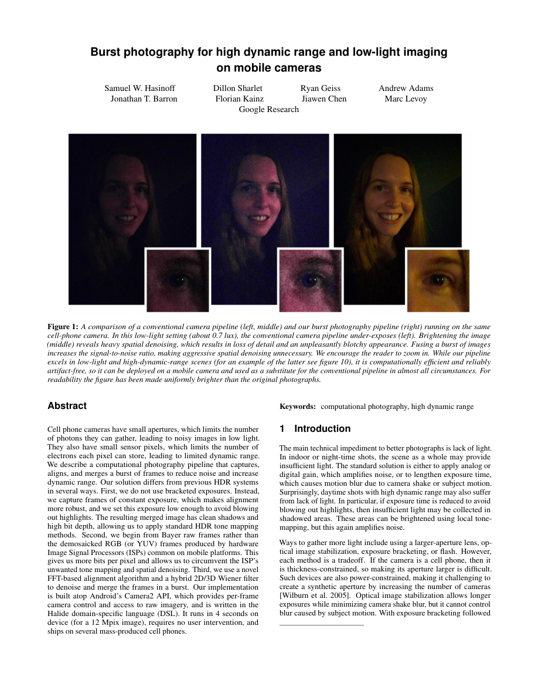
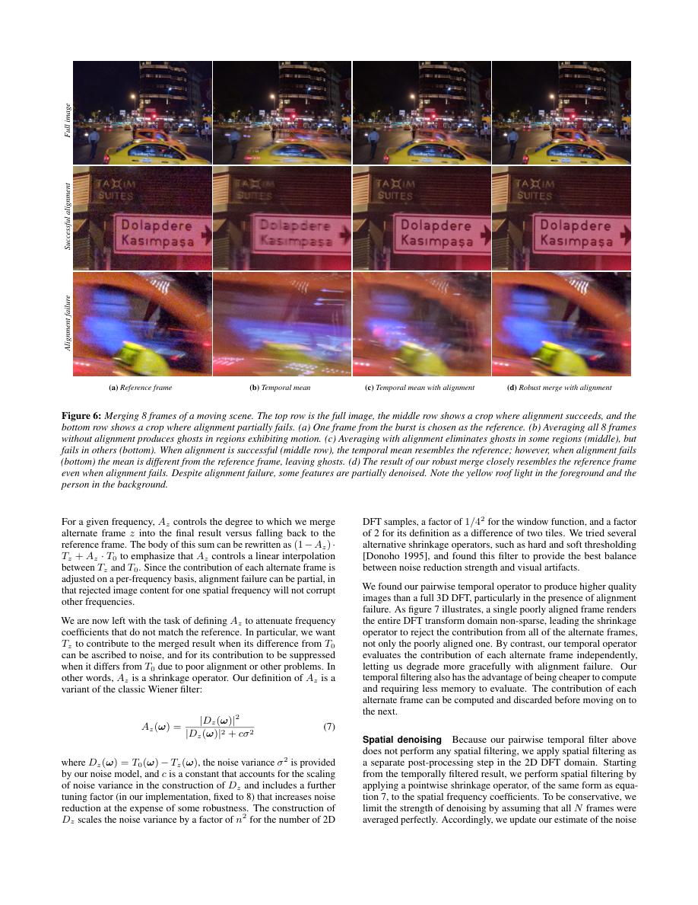
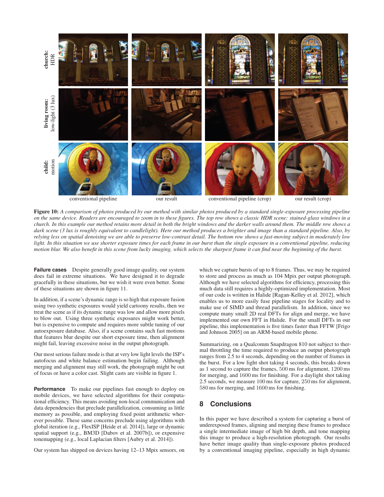
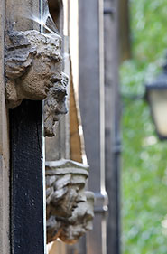
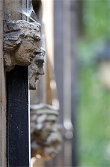
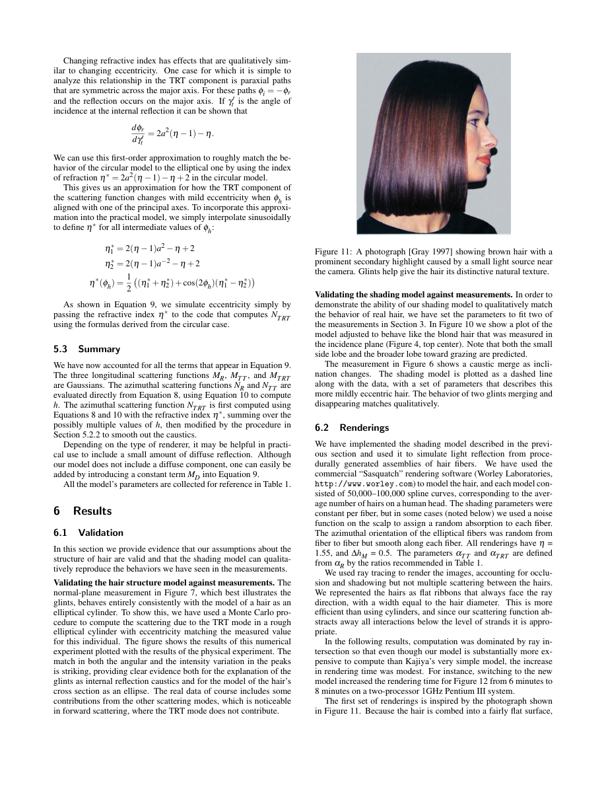
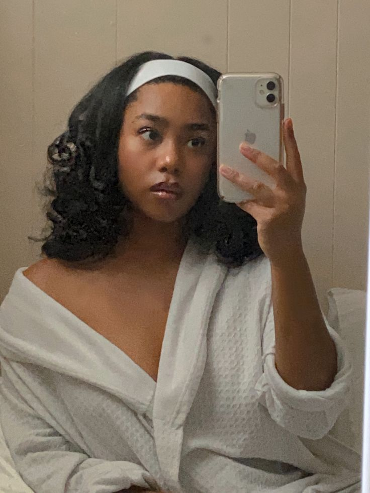

# Atlas de reconstrução fotográfica

Inspeção manual em 12/10/2026. Os hashes dos originais e metadados estão no [manifesto](reference_manifest.json). Os previews de PDF são rasterizações para leitura; não foram retocados. Coordenadas esquerda/direita referem-se ao quadro. Os intervalos abaixo são **receitas plausíveis de reconstrução**, não medições extraídas de pixels. Não há calibração de escala, RAW ou bastidores completos para a maioria dos casos. Temperatura da fonte e WB não podem ser separados com certeza em um JPEG.

## R02 — retrato em sombra aberta, sol no cabelo

Fonte: [Lies Thru a Lens / Wikimedia](https://commons.wikimedia.org/wiki/File:Natural_Light_Portrait_of_Rosie_(20710648621).jpg), CC BY 2.0, original preservado.

**DOCUMENTED:** autor descreve árvore e retoque por separação de frequências. EXIF local: Sony ILCE-7R, 85 mm, f/3.5, 1/400 s, ISO 100. A descrição menciona f/2.8 e ISO 125: conflito preservado; EXIF descreve o arquivo, não prova sessão sem edição.

**OBSERVED:** brilho intenso na parte superior esquerda do cabelo; rosto com gradação suave; olhos e mechas mais definidos que vegetação; mão atravessa o primeiro plano; pele facial suavizada, antebraço com mais textura.

**INFERRED / reconstrução:** câmera perto da altura dos olhos, enquadramento cerrado; distância proposta 1–2 m, não confirmada. Sol alto filtrado/ocluído e céu amplo preenchendo a frente; posições/distâncias exatas desconhecidas. Fundo verde a distância explica blur e possível contribuição ambiental discreta. Cor relativamente neutra no rosto, cabelo quente, highlights muito fortes. Não é necessário simular ruído ou aumentar poros. Mecanismo transferível: separar luz de rosto e cabelo mantendo origem ambiental comum; preservar plano de foco e ocultações.

## R03 — retrato de rua com luz direta

Fonte: [istolethetv / Wikimedia / Flickr](https://commons.wikimedia.org/wiki/File:Freckles_(1351739811).jpg), CC BY 2.0. EXIF local Sony DSC-H7, **48,9 mm físicos**, f/5, 1/500 s, ISO 100, sem flash; Photoshop CS2. Não confundir 48,9 mm com equivalente full frame.

**OBSERVED:** perfil ocupa primeiro plano; fundo com pessoas cortadas e desfocadas; variação de pigmento, maquiagem, brilho pontual na testa, separação de fios; sombra forte em cavidades e sob mandíbula. Repetição de lantejoulas é estrutura real do acessório, não evidência automática de clonagem.

**INFERRED / reconstrução:** câmera à altura do rosto, posição lateral, recorte tele; distância em metros UNKNOWN sem escala/crop. Fonte pequena angular, alta e dianteira à esquerda do quadro; céu/rua preenchem sombras. Distância do sol efetivamente remota; intensidade relativa e Kelvin não recuperáveis. Manter fundo menos nítido e mais escuro, sem vinheta inventada. Mecanismo transferível: a luz revela textura localizada; sardas e maquiagem pertencem à pessoa desta foto, não à identidade da Nina.

## R05 — produto refletivo com iluminação controlada

Fonte: [Profoto, PDF hospedado pela Fimeko](https://www.fimeko.fi/pdf/Creating_long_and_even_highlights_with_softboxes.pdf), consulta interna.

**DOCUMENTED:** quatro softboxes na configuração final; fonte maior, strips e luz traseira com gel verde são adicionadas em etapas. **OBSERVED:** faixas de brilho acompanham curvatura das garrafas/taça; mesa reflete bases; transparência varia entre vidro escuro, claro e líquido.

**INFERRED / reconstrução:** câmera frontal próxima à altura dos rótulos, suporte estável; focal, abertura, distância e potências UNKNOWN. Para reproduzir a lógica, usar lente normal/tele curta, foco cobrindo rótulos, fontes verticais fora do quadro e superfície de apoio refletiva. Não afirmar esses parâmetros como originais. Fundo verde não implica que toda a frente deva ficar verde. O caso refuta “objeto muito limpo sempre parece IA”: polimento e controle de fontes explicam o resultado.

## R06 — quatro situações de fotografia computacional

Fontes: [Hasinoff et al., preprint](https://people.csail.mit.edu/hasinoff/pubs/HasinoffEtAl16-hdrplus-preprint.pdf), comparações publicadas, consulta interna. Sem EXIF individual disponível nas figuras.

**R06-FACE:** câmera frontal ao sujeito; distância/lente/abertura UNKNOWN. Rosto iluminado, fundo escuro; processamento melhora textura/ruído. Reconstrução: luz doméstica direcional fraca com ambiente reduzido, foco no rosto; não iluminar o fundo independentemente.

**R06-STREET:** câmera na rua, veículos próximos e edifícios atrás. Múltiplas fontes pontuais, reflexos coloridos e movimento. Reconstrução: campo amplo, exposição de noite e materiais recebendo luz local; as versões mostram diferenças de merge/alinhamento, não todas “defeitos de IA”.

**R06-CHURCH:** câmera voltada aos vitrais; interiores escuros, janelas claras. Focal/posição métrica UNKNOWN. Reconstrução: janelas como fontes extensas, contraste de ambiente preservado; processamento pode recuperar detalhes sem transformar paredes em emissores.

**R06-ROOM:** câmera oblíqua diante de piano/estante; tons quentes, sombras grandes. Reconstrução: fonte doméstica fraca e apoio/reflexão coerentes; configurações individuais UNKNOWN. A versão mais clara não comprova mudança na iluminação.

Para os quatro: WB, tone mapping e redução de ruído fazem parte da aparência final; não se consegue deduzir intensidade física ou Kelvin apenas pelo brilho do JPEG. Não copiar as pessoas, marcas ou texto das figuras. São quatro situações, cada comparação contém imagens relacionadas, não amostras independentes.

## R07 — abertura: mesmo motivo, blur diferente

 

Fonte: [Cambridge in Colour](https://www.cambridgeincolour.com/tutorials/depth-of-field.htm), consulta interna. **DOCUMENTED:** comparação f/8 e f/2.8 com 200 mm, enquadramento descrito como 320 mm equivalente.

**OBSERVED:** pedra em primeiro plano permanece legível; detalhes arquitetônicos e fundo verde perdem definição com abertura maior. Blur respeita profundidade, não o significado “pedra vs fundo”.

**INFERRED / reconstrução:** câmera oblíqua à fachada, altura e distância UNKNOWN; foco em elemento próximo. Luz ampla de dia; fontes fora do recorte, tamanho/distância/temperatura UNKNOWN. Não estimar abertura pela aparência quando a fonte fornece o valor. Ruído, balanço e sharpening não isolados pelo par. Mecanismo transferível: escolher plano de foco e transição gradual, sem borrar todos os objetos secundários por igual.

## R08 — cabelo e highlight direcional

Fonte: [Marschner et al. 2003](https://www.cs.cornell.edu/~srm/publications/SG03-hair.pdf), fotografia atribuída no artigo a Gray 1997. A página contém também texto técnico; a figura é identificada como foto, não render.

**DOCUMENTED:** legenda identifica fonte pequena próxima da câmera. **OBSERVED:** faixa de brilho cruza cabelo penteado; topo escuro e pequenos glints coexistem. **INFERRED:** perfil, câmera perto da altura do rosto; focal, distância, abertura, potencia, WB e retoque UNKNOWN. Fundo simples permite alta legibilidade do penteado. Replicação: highlight acompanha a orientação das fibras e muda ao longo da curvatura; não desenhar linhas luminosas iguais em todos os fios. Fonte near-camera não significa pele inteira branca ou cabelo sem sombras entre mechas.

## P03 — Pinterest, selfie no espelho

Fonte: [pin](https://uk.pinterest.com/pin/mirror-selfie--794111346795483355/), biblioteca `P01_MIRROR`. Autoria/captura/autenticidade **UNKNOWN**. Nova inspeção dos mesmos pixels, não nova coleta de foto comprovada.

**OBSERVED:** telefone ao lado do rosto, robe com textura, parede neutra, contraste moderado, variações finas semelhantes a ruído/compressão. Cotovelo e parte do corpo ficam fora do quadro. Reflexo do telefone mostra sua traseira; é lógica de espelho, não câmera frontal direta.

**INFERRED / receita plausível:** câmera aproximadamente ao nível do rosto, caminho óptico via espelho; distância total câmera–espelho–sujeito pode ser maior que a distância física mão–rosto. Aparência de campo amplo de celular; lente/abertura/distância exatas UNKNOWN. Luz frontal/superior ampla com preenchimento de paredes; número de luminárias e Kelvin UNKNOWN. Preservar assimetria do enquadramento, peso do robe e grão discreto já existente, sem replicá-lo sobre a futura Nina automaticamente. Transferir câmera/pose; identidade é exclusivamente canônica.

## P04 — Pinterest, bancada com espelho e vários materiais

Fonte: [pin](https://www.pinterest.com/pin/my-absolute-favorite--1759287346258436/), biblioteca `P02_VANITY`. Autoria/câmera/autenticidade **UNKNOWN**.

**OBSERVED:** luminárias brancas muito claras; frascos transparentes/âmbar, plásticos opacos, correntes, flores, objetos sobrepostos e reflexos no espelho. A bancada não é uma composição completamente isolada; itens atrás aparecem parcialmente.

**INFERRED / receita plausível:** câmera acima da bancada, olhar levemente para baixo e oblíquo ao espelho; proposta normal/ampla, distância 0,5–1,5 m apenas como montagem possível. Bulbos são fontes visíveis, ambiente também contribui; sombras suaves e reflexos multiplicados. Não transformar todos os highlights em discos brancos iguais. Campo em foco relativamente amplo; abertura/stacking/processamento UNKNOWN. Cor rosa vem de objetos/ambiente, não exige tingir todas as superfícies. Marcas permanecem autoridade do produto real, não devem ser copiadas deste pin.

## Padrões recorrentes e limites

Observados em mais de um caso: diferenças de nitidez por profundidade; brilho distinto por material; áreas ocultas/cortadas; fontes fora do quadro; detalhe local sem nitidez uniforme; aparência final afetada por processamento. Não observados como regra universal: ruído, flare, pele rugosa, clipping, bagunça ou assimetria deliberada. Tais efeitos são opcionais e condicionais.

A amostra cobre retrato retocado, retrato de rua, cabelo, produto de estúdio, arquitetura, noite e interiores; moda com tecidos diferentes é sustentada pela pesquisa técnica, **não** por um corpus visual específico de cada fibra. Técnica inferida de uma foto não é configuração histórica autenticada. Nenhuma destas referências redefine rosto/corpo da Nina ou design gráfico do perfil.
